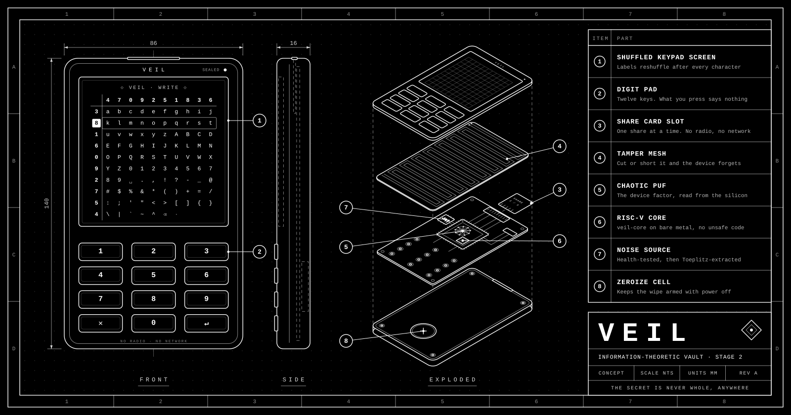

# Veil

<p align="center">
  
</p>

Stage 1 of a long-term vault for one small file (up to 10,240 bytes). The file is split into *n*
shares. Any *k* of them rebuild it, and fewer reveal nothing, however much computing power an attacker
has. The byte format is in [SPEC.md](SPEC.md).

## Use

```sh
cargo build --release
B=./target/release/veil

$B split secret.txt -o e0/                 # 3-of-5 by default; -k and -n to change
$B check e0/*-2of5.veil e0/*-4of5.veil     # cross-checks shares, rebuilds nothing
$B refresh e0/*.veil -o e1/                # every share moves to epoch 1
$B combine e1/*-1of5.veil e1/*-3of5.veil e1/*-5of5.veil -o recovered.txt
```

`refresh` needs every share in one place. To refresh with the shares kept apart:

```sh
$B keycard my-share.veil                  # each vault: 92 bytes, no share data; send it to the dealer
$B deal *.veilkey                         # the dealer: one mask per vault; send each to its own vault
$B apply my-share.veil my-share.veilmask  # each vault: writes its next-epoch share
```

Record the set ID that `split` prints somewhere separate from the shares. `combine` prints it again,
so you can confirm you recovered the right set.

After a refresh, destroy the old shares. Until they're gone, any *k* of them still rebuild the file.

## Composed keys: shares AND your words

`compose` protects a 32-byte master key with two factors: the shares and 27 words that you keep
yourself. Neither reveals anything alone. Even all 5 holders together learn nothing without your
words, and your words alone learn nothing without 3 shares.

```sh
$B compose -o shares/                       # new random key, 5 shares, 27 words printed once
$B compose --key my.key -o shares/          # or protect an existing 32-byte key
$B recover shares/*-1of5.veil shares/*-3of5.veil shares/*-5of5.veil -o my.key   # asks for the words
```

`forge` goes a step further: the key is **born split**. Veil draws the shares' part and your words
independently at random, so the key is only ever *defined*, as their XOR, and nothing computes it
until `recover`. No key file is written, because there is no key yet. At a keyboard, your keystrokes
(their timing and value) ripple into the randomness it's made from. They're mixed in with XOR, so
they can only add randomness.

```sh
$B forge -o shares/          # type 64 keys; 5 shares and 27 words come out, the key does not
```

The forging machine still sees both parts for a moment, since your words have to be shown to you,
so the key is computable there, just never computed. Making even that impossible needs the shares
to be born on separate devices.

- **One check, at the end.** A wrong word, a wrong share or a share from another set all fail the
  same way: "the shares and the words do not combine". Nothing says which factor was wrong.
- **Typos are caught first** by a checksum inside the words, which reveals nothing about the key.
  Each word can be typed as just its first four letters. The list is BIP-39 English.
- **Why 32 bytes:** for perfect secrecy, your words must hold as much randomness as the key they
  protect, and 27 words is about what a person can keep. To protect something larger, encrypt it
  with the master key.
- **The cost:** there is exactly one way in. Lose the words and the key is gone for good.

The core can also require a **device**: a third factor rebuilt from a chip's physical response by a
fuzzy extractor (see [SPEC.md](SPEC.md)), so the key needs the shares AND the words AND that chip.
It's ready in the library and waits on PUF hardware before the command line offers it.

One known attack shapes how a device must use it: someone who can alter the helper data *and*
watch whether recovery succeeds learns about the chip a little at a time. The extractor never
reports decoding failures, but the final success or failure is still visible, so a device must keep
its helper data inside its tamper boundary and limit failed attempts.

## Writing a secret straight into Veil

`write` lets you type a secret without it ever existing as a file. Each character is split the
moment you choose it, so the text never exists whole: not in memory, not on disk, not on screen.

```sh
$B write -o shares/          # type through the keypad, then enter; combine brings it back
```

You type through a shuffled keypad. Every printable character sits in a fixed 10 × 10 grid, and the
rows and columns are labelled with digits that **reshuffle after every character**. Find your
character, press its row's digit, then its column's digit. Those digits are uniformly random
whatever you typed, so someone who hears, logs or films your keys learns nothing, unless they also
see the screen. Deleting and padding are cells in the grid too, so they look like any other
character.

What it can't hide:

- **The length.** Anyone counting key presses learns how many characters you typed. Pad cells can
  disguise it.
- **Screen and keys together.** A camera that sees both, or malware on the same machine, can match
  them up.
- **Human-chosen text.** If you choose the words, they may be guessable wherever they're used. When
  a secret doesn't have to be your own words, `forge` is stronger: there's nothing to type.

## Randomness

Every guarantee rests on the random bytes being uniform. By default they come from the OS generator,
which is computational. To remove that assumption, feed in a hardware noise source:

```sh
$B seed -o seed.txt < rolls.txt          # once: 272 rolls of a fair die. The seed is public
$B split secret.txt --entropy /dev/cu.usbmodem1 --min-entropy 7 --seed seed.txt
```

`split`, `refresh` and `deal` all take these flags. The raw noise goes through three layers:

1. **Health tests.** NIST SP 800-90B's repetition count and adaptive proportion tests, with a 2⁻³⁰
   false alarm rate, stop everything if the device sticks or loses its entropy.
2. **Extraction.** A Toeplitz matrix turns each 64-byte raw block into up to 16 bytes within 2⁻⁶⁴ of
   uniform or better, by the Leftover Hash Lemma. The seed fixes the matrix. It can be public and
   reused, but it must be uniform and independent of the noise, so it comes from dice.
3. **Mixing.** The result is XORed with the OS generator, so a broken source can never make things
   worse.

After each operation, `veil` prints what the randomness rested on and the bound it achieved.

Health tests catch broken devices, not clever fakes, and `--min-entropy` is a claim about the physics
of your device. Use the figure from its documentation or from NIST's SP 800-90B assessment tool on a
raw sample, and go lower when unsure: it only costs speed. `--entropy` reads raw bytes from any device,
pipe or capture file. Never feed it the same capture twice.

## Using Veil safely

The math holds whatever an attacker can compute. What remains is the room, the paper and the people.
One rule covers most of it: **no single person, building, account, company or government should
ever be able to reach everything the secret needs**: *k* shares, plus your words for a composed key.
Everything below applies that rule to one step at a time.

**The machine**

- [ ] Run `split`, `combine`, `compose`, `forge`, `recover` and `write` on an offline machine you
  trust, ideally booted fresh from a live USB. Veil keeps its memory out of swap and crash dumps and
  blocks debuggers, but malware on the same machine sees whatever Veil sees.
- [ ] Build from source you have read, with the committed `Cargo.lock`:
  `cargo build --release --locked`.
- [ ] Keep secrets and shares out of synced and backed-up folders: iCloud Desktop & Documents,
  Dropbox, Time Machine, snapshots. Work on a RAM disk, which disappears at power-off:

  ```sh
  diskutil erasevolume HFS+ veil-ram $(hdiutil attach -nomount ram://65536)   # macOS, 32 MB
  ```

  On Linux, use a `tmpfs` mount on a machine whose swap is off or encrypted.

**Splitting**

- [ ] Prefer `write` or `forge`, so the secret never exists as a file. `split` needs a file, and
  deleting a file from flash storage doesn't reliably erase it, so keep that file on the RAM disk.
- [ ] `split` writes all *n* shares into one folder, which therefore holds the secret. Put that
  folder on the RAM disk, copy each share to its own medium, then power off.
- [ ] Choose *k* as the number of holders a thief must reach, and *n* − *k* as the number of shares
  you can afford to lose.
- [ ] Before any share leaves the room, run `veil check` on all of them. For a composed or forged
  key, also prove that you wrote the words down correctly: `veil recover … -o - > /dev/null` exits
  with 0 only if the shares and words combine. The key goes nowhere.
- [ ] Record the set ID that Veil prints, away from the shares.

**Your words** (`compose` and `forge`)

- [ ] Write them on paper or stamp them in metal. Never type them into a phone, a photo, a password
  manager or a cloud note.
- [ ] Words alone reveal nothing, so a second copy in another place is safe, as long as no copy ever
  sits alongside *k* shares. Losing every copy loses the key for good.
- [ ] Let the words print only to the terminal. Veil refuses to send them to a file or pipe unless
  you pass `--words-off-screen`, but the terminal itself keeps them: clear the scrollback afterwards
  (⌘K in macOS Terminal), and don't run inside a session recorder, `script` or a logging `tmux`.

**Typing** (`write`)

- [ ] Make sure no camera can see the screen; the keys alone give nothing away. Add pad cells if the
  length of the secret matters.

**Holding shares**

- [ ] One share per holder. Choose holders who wouldn't collude, can't be pressured together, and
  ideally don't live under the same jurisdiction.
- [ ] A share file is not encrypted: whoever reads *k* of them has the secret. Store each one on its
  own medium. Email and cloud storage are acceptable only if no single provider or account ever
  holds *k* shares.
- [ ] Each holder keeps two copies on different media, and checks once a year that they still read.

**Refreshing**

- [ ] Refresh when a holder leaves, when a share may have been copied, and once a year anyway.
- [ ] A refresh only helps once every old share, keycard and mask is destroyed, everywhere. On flash
  storage, destroying them means physically destroying the media.
- [ ] Refresh needs every share. If one is lost, rebuild and split into a new set instead: `combine`
  then `split`, or for a composed key, `recover` then `compose --key`.
- [ ] If a share file was ever read by someone else, a refresh restores secrecy but not full tamper
  protection: the hash keys inside it survive refreshes, so that reader could later forge a share
  that passes its checks. Rebuild and split into a new set to replace them.
- [ ] If *k* shares of one epoch were ever exposed together, the secret is out for good.

**Recovering**

- [ ] Use the same kind of offline machine. Write the output to the RAM disk, or with `-o -`
  straight into the program that needs it.
- [ ] Present every share you can gather, not just *k*. Any genuine share among them exposes a
  forged one. Then check that the set ID matches your record.
- [ ] Power off when done.

## What is proven and what is assumed

| Property | Basis |
|---|---|
| Fewer than *k* shares reveal nothing | Information-theoretic (Shamir). Checked by exhaustive enumeration for *k* = 2 and *k* = 3 over every index pair |
| Altered shares are caught and named | Information-theoretic one-time POLYVAL tags between every pair of shares. Forgery chance below 2⁻¹¹⁸ per check |
| Refresh never rebuilds the file | The masks are dealt from hash keys alone: `deal` never receives share data. Each share is then XORed with its own mask. Dealing from keycards gives byte-for-byte the same masks as dealing from the shares |
| Old and new shares don't combine | Each refresh puts the shares on a fresh random curve. Checked exhaustively for one old plus one new share at *k* = 2 |
| Composed keys need shares and words together | For any key you pick, some set of words would open the same shares to it, so the shares say nothing about which key it is. Tested constructively |
| The device factor survives noise | The Golay code's distance and its correction of every pattern of up to 3 errors are checked exhaustively. On simulated chips, the factor was rebuilt 200/200 times at the enrollment temperature and 197/200 at +20 °C, and never by another chip (0/90) |
| A forged key is never computed | By construction: `forge` draws both parts at random and computes the check term by term, using POLYVAL's linearity. Recovery lands exactly on their XOR, which also proves the check right |
| Typed secrets never exist whole | `write` splits each character the moment it's chosen. The keypad's digit labels are uniform shuffles (the random draw is checked exhaustively for bias), and a simulated user reading each shuffled screen types a secret that recombines exactly |
| Field arithmetic is correct | All 65,536 products checked against an independent reference |
| Secrets stay out of swap and crash dumps | Memory pinned with `mlock` and zeroed after use, core dumps disabled, debugger attachment blocked |
| Randomness is uniform | With `--entropy` and a dice seed, no computational assumption remains: the output is within a stated distance of uniform. The extractor is checked exhaustively for the universal property the proof needs, and the health test cutoffs match NIST's published table |
| **The source delivers its declared min-entropy** | **Physical assumption.** Software can't verify it; it's a claim about the device. Without `--entropy`, the OS generator alone is used, and the assumption is computational instead |
| **The dealer is trusted** | **Known limit.** The dealer could keep the masks, and with them later convert stolen old shares to the current epoch. It must destroy them |
| **Hash keys never change** | **Known limit.** Refresh replaces pads but keeps hash keys, so someone who once read a share's keys can later forge tags towards it. Combining and re-splitting replaces them |

## Layout

- `veil-core/`: the scheme, the extractor and the health tests. `no_std`, no `unsafe`, builds for
  bare-metal RISC-V
  (`cargo build -p veil-core --target riscv32imac-unknown-none-elf`).
- `veil-cli/`: the `veil` command. All `unsafe` code is in `src/harden.rs`.

## Experiments

`experiments/puf-sim` models a chaotic PUF before hardware exists:

```sh
cargo run --release -p puf-sim               # when responses are unique and stable
cargo run --release -p puf-sim --bin fuzzy   # the device factor end to end on simulated chips
```

## Not done yet

- A run with a real hardware noise source. So far the hardware path has only seen simulated noise
- Kani proofs for the parsing code
- Stage 2 (bare-metal RISC-V on an FPGA) and stage 3 (recovery in fixed logic, no CPU)
