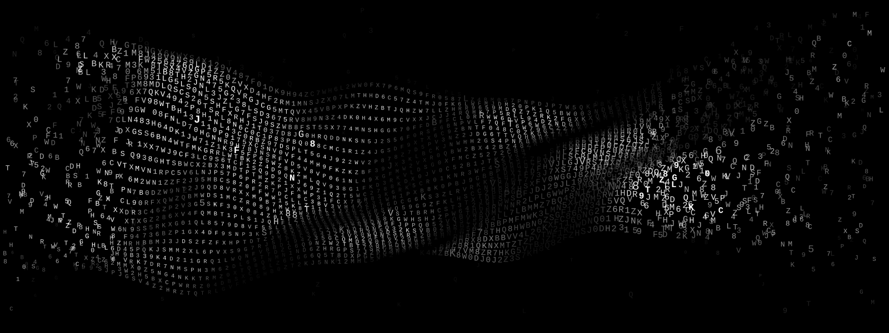

# Veil

<p align="center"></p>

> [!WARNING]
> **Experimental and unaudited.** The math is proven, but this code has not been independently
> reviewed. Don't trust real secrets to it yet. To report a flaw, see [SECURITY.md](SECURITY.md).

Veil splits one small file, up to 10 KB, into *n* shares. Any *k* of them rebuild it. Fewer reveal
nothing, however much computing power an attacker has, and tampering is caught with the same
unconditional guarantee. The byte format is in [SPEC.md](SPEC.md).

## Use

```sh
cargo build --release --locked
B=./target/release/veil
mkdir shares next keys

$B split secret.txt -o shares/        # 3 of 5 by default; -k and -n to change
$B check shares/*.veil                # cross-checks the shares, rebuilds nothing
$B combine shares/*-1of5.veil shares/*-3of5.veil shares/*-5of5.veil -o recovered.txt
$B refresh shares/*.veil -o next/     # fresh shares, same file; destroy the old ones
```

Keep the set ID that `split` prints away from the shares, and check it when `combine` prints it
again. `veil help` lists everything else.

## Beyond splitting

- **Composed keys.** `compose` protects a 32-byte key with the shares *and* 27 words you keep.
  Neither reveals anything alone, and losing the words loses the key. With `forge`, the key is born
  split: nothing computes it until `recover`.
- **Polyglot words.** If you read English, Tamil, Hindi and Russian, `--polyglot` spells the same
  bits in 23 words instead of 27, such as `пингвин toast முதுமை लोहा`.
- **Typing straight in.** `write` takes a secret through a shuffled keypad and splits each character
  the moment you choose it, so the text never exists whole.
- **Refreshing apart.** `keycard`, `deal` and `apply` move a set to a new epoch without the shares
  ever meeting.
- **Hardware randomness.** `--entropy` takes raw noise through health tests and a dice-seeded
  extractor, then XORs it with the OS generator, so no computational assumption remains.

```sh
$B forge -o keys/                     # 5 shares and 27 words come out; the key does not
$B recover keys/*-1of5.veil keys/*-3of5.veil keys/*-5of5.veil -o my.key   # asks for the words
```

## Using it safely

No single person, place, account or government should ever be able to reach everything the secret
needs: *k* shares, plus your words. Work offline on a RAM disk, keep one share per holder, and
destroy old shares after a refresh. The full checklist, and what Veil can't hide, is in
[docs/safety.md](docs/safety.md).

## What is proven and what is assumed

| Property | Basis |
|---|---|
| Fewer than *k* shares reveal nothing | Information-theoretic (Shamir), checked exhaustively for *k* = 2 and 3 |
| Altered shares are caught and named | One-time POLYVAL tags between every pair of shares; forgery below 2⁻¹¹⁸ |
| Refresh never rebuilds the file | Masks are dealt from hash keys alone; the dealer never sees share data |
| Composed keys need shares and words | Every key fits the shares for some set of words |
| Forged keys and typed secrets never exist whole | By construction, and checked end to end |
| Randomness is uniform | With `--entropy` and a dice seed, within a stated distance of uniform |
| **The source's declared min-entropy** | **Physical assumption.** Without `--entropy`, a computational one about the OS generator |
| **The dealer** | **Known limit.** Trusted to destroy the masks |
| **Hash keys** | **Known limit.** Refresh keeps them; re-split to replace them |

## Status

- `veil-core/` holds the scheme. It is `no_std`, has no `unsafe`, and builds for bare-metal RISC-V.
- `veil-cli/` is the `veil` command. All its `unsafe` code is in `src/harden.rs`.
- `experiments/` simulates a chaotic PUF and rebuilds the word lists.

Not done yet: a real hardware noise source, a PUF chip for the device factor the core already
supports, Kani proofs for the parsing code, an independent audit, a bare-metal device
([concept](docs/veil-device.svg)) and, after it, recovery in fixed logic with no CPU.

## License

Licensed under either the [Apache License, Version 2.0](LICENSE-APACHE) or the
[MIT license](LICENSE-MIT), at your option. Unless you explicitly state otherwise, any contribution
you intentionally submit for inclusion in Veil, as defined in the Apache-2.0 license, is dual
licensed as above, without any additional terms or conditions.
